I've spent more than 15 years in digital design. I started out as a computer technician, trained as a UX/UI designer, and ended up building the frontend of the things I design. Today I work where the two meet: deciding how a product should feel, then making it real.

**Now**

- [Arakun](https://github.com/ArakunHQ/arakun): co-creator. A native desktop app for working with coding agents, built in Rust.
- [CoderLabs](https://www.coderlabs.dev): our software development company.

**Before**

- [Glass Morphism Generator](https://github.com/daniektj/Glass-Morphism-Generator): a CSS generator, 95 ★

[LinkedIn](https://www.linkedin.com/in/daniektj/) · [X](https://x.com/daniektj) · Tijuana, México
